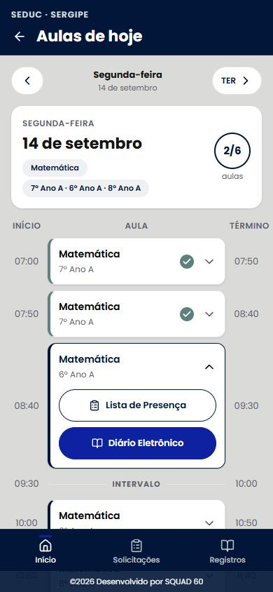

<div align="center">

# 🎓 Diário Eletrônico — SEDUC/Sergipe (Portal do Professor)

**App do professor: aulas do dia, presença e diário eletrônico**
*Teacher portal: daily classes, attendance and digital class journal*


[**Português**](#-português) · [**English**](#-english)

<br/>



</div>

---

## 🇧🇷 Português

### Sobre

Aplicativo **mobile-first** do portal do professor da rede estadual (SEDUC/Sergipe), projeto
acadêmico do **Squad 60**. A primeira tela entregue é a **Aulas de Hoje**: lista as aulas do
dia na ordem do horário, mostra quantas já foram concluídas e dá acesso rápido à Lista de
Presença e ao Diário Eletrônico de cada aula.

### Funcionalidades (tela Aulas de Hoje)

- 📅 **Navegação por dia** com o dia na URL (`?data=`) — setas, link direto e o botão *Voltar* do navegador funcionam
- 📊 **Resumo do dia**: disciplinas, turmas e contador de **concluídas/total**
- 🗂️ **Lista no horário do turno** (com intervalo no lugar certo)
- 🔽 **Cards expansíveis** (um aberto por vez; a 1ª aula pendente já abre)
- 🎨 **Design System Squad 60** (Paleta B, Poppins) com tokens de cor — sem hex nos componentes
- ⏳ **Estados** de carregando (skeleton), erro (com *tentar novamente*) e vazio

### Stack

**React 19** · **Vite 6** · **React Router 7** · **lucide-react** (ícones SVG) · CSS com
*design tokens*. Dados simulados por mocks + um serviço assíncrono (pronto para trocar por API).

### Como rodar

```bash
npm install
npm run dev      # http://localhost:5173
npm run build    # build de produção
npm run lint
```

### Estrutura

```
src/
├── pages/professor/      # Aulas de Hoje (+ telas provisórias)
├── components/           # AppShell, SeletorDia, ResumoDia, CardAulaDia, estados
├── hooks/useDados.js     # busca assíncrona (carregando/erro/recarregar)
├── services/             # aulaService (listar aulas do dia/semana)
├── lib/                  # datas, horários, cor por turma, mockUtils
└── mocks/aulas.json      # dados de exemplo
```

---

## 🇺🇸 English

### About

A **mobile-first** teacher-portal app for the state education network (SEDUC/Sergipe), an
academic project by **Squad 60**. The first delivered screen is **Today's Classes**: it lists
the day's classes in time order, shows how many are already done, and gives quick access to each
class's Attendance list and digital Journal.

### Features (Today's Classes screen)

- 📅 **Day navigation** with the day in the URL (`?data=`) — arrows, deep links and the browser *Back* button all work
- 📊 **Day summary**: subjects, classes and a **done/total** counter
- 🗂️ **Shift-schedule list** (with the break placed correctly)
- 🔽 **Expandable cards** (one open at a time; the first pending class opens by default)
- 🎨 **Squad 60 Design System** (Palette B, Poppins) with color tokens — no hex in components
- ⏳ **Loading** (skeleton), **error** (with retry) and **empty** states

### Stack

**React 19** · **Vite 6** · **React Router 7** · **lucide-react** (SVG icons) · CSS design
tokens. Mocked data behind an async service (ready to swap for a real API).

### Getting started

```bash
npm install
npm run dev      # http://localhost:5173
npm run build
npm run lint
```

---

<div align="center">

Projeto acadêmico — **Squad 60** · Desenvolvido por **[@teuzslima](https://github.com/teuzslima)**

</div>
