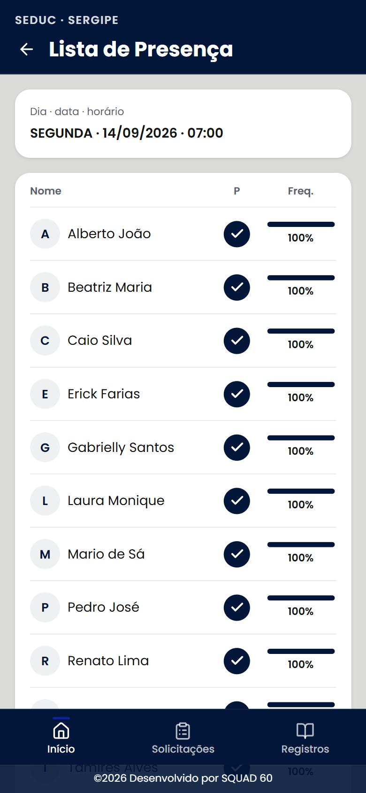

<div align="center">

# 🎓 Diário Eletrônico — SEDUC/Sergipe (Portal do Professor)

**App do professor: aulas do dia, lista de presença e diário eletrônico**
*Teacher portal: daily classes, attendance list and digital class journal*


[**Português**](#-português) · [**English**](#-english)

<br/>


&nbsp;&nbsp;


</div>

---

## 🇧🇷 Português

### Sobre

Aplicativo **mobile-first** do portal do professor da rede estadual (SEDUC/Sergipe), projeto
acadêmico do **Squad 60**. Telas entregues até aqui: **Aulas de Hoje** e **Lista de presença**.

### Telas

**📅 Aulas de Hoje** · `/professor/aulas-hoje`
- Navegação por dia com o dia na URL (`?data=`) — setas, link direto e o *Voltar* do navegador
- Resumo do dia (disciplinas, turmas e contador de concluídas/total)
- Lista no horário do turno (com o intervalo no lugar certo) e cards expansíveis (um aberto por vez)

**✅ Lista de presença** · `/professor/presenca`
- **Chamada da turma**: marca presente/ausente por aluno, com **modo leitura e modo edição** (e cancelar)
- **Frequência** de cada aluno calculada das regras, com três cores: normal, **atenção** e **limite**
- **Observações automáticas** dos alunos perto ou no limite de faltas (geradas dos dados)
- **Envio** com "Enviando…", **toast** de sucesso/erro — e, no erro, mantém as marcações
- **Acessibilidade**: botões da coluna presença com `aria-pressed` e `aria-label`

Comuns às telas: **Design System Squad 60** (Paleta B, Poppins) com tokens de cor (sem hex nos
componentes), e **estados** de carregando (skeleton), erro (com *tentar novamente*) e vazio —
testáveis por `?estado=carregando`, `?estado=erro` e `?estado=erro-envio`.

### Stack

**React 19** · **Vite 6** · **React Router 7** · **lucide-react** (ícones SVG) · CSS com
*design tokens* · toast próprio (sem dependência externa). Dados simulados por mocks + um serviço
assíncrono (pronto para trocar por API).

### Como rodar

```bash
npm install
npm run dev      # http://localhost:5173
npm run build    # build de produção
npm run lint
```

### Estrutura

```
src/
├── pages/professor/      # AulasHoje, ListaPresenca (+ telas provisórias)
├── components/
│   ├── professor/        # SeletorDia, ResumoDia, CardAulaDia, CardDataAula
│   └── ...               # AppShell, Toaster, EstadoErro, Skeleton
├── hooks/useDados.js     # busca assíncrona (carregando/erro/recarregar)
├── services/             # aulaService (aulas do dia/semana, chamada, envio)
├── lib/                  # datas, horários, frequência, cor por turma, mockUtils, toast
└── mocks/                # aulas.json, alunos.json
```

---

## 🇺🇸 English

### About

A **mobile-first** teacher-portal app for the state education network (SEDUC/Sergipe), an
academic project by **Squad 60**. Screens delivered so far: **Today's Classes** and **Attendance list**.

### Screens

**📅 Today's Classes** · `/professor/aulas-hoje`
- Day navigation with the day in the URL (`?data=`) — arrows, deep links and the browser *Back*
- Day summary (subjects, classes and a done/total counter)
- Shift-schedule list (break in the right place) and expandable cards (one open at a time)

**✅ Attendance list** · `/professor/presenca`
- **Class roll call**: mark each student present/absent, with **read and edit modes** (and cancel)
- **Attendance rate** per student from the rules, in three colors: normal, **warning** and **limit**
- **Auto-generated notes** for students near or at the absence limit (derived from the data)
- **Submit** with a "Sending…" state and success/error **toast** — markings kept on error
- **Accessibility**: presence-column buttons with `aria-pressed` and `aria-label`

Shared: **Squad 60 Design System** (Palette B, Poppins) with color tokens (no hex in components),
and **loading** (skeleton), **error** (with retry) and **empty** states — testable via
`?estado=carregando`, `?estado=erro` and `?estado=erro-envio`.

### Stack

**React 19** · **Vite 6** · **React Router 7** · **lucide-react** (SVG icons) · CSS design
tokens · in-house toast (no external dependency). Mocked data behind an async service (ready to
swap for a real API).

### Getting started

```bash
npm install
npm run dev      # http://localhost:5173
npm run build
npm run lint
```

---

<div align="center">

Projeto acadêmico — **Squad 60** · Desenvolvido por **[@teuzslima](https://github.com/teuzslima)**

</div>
